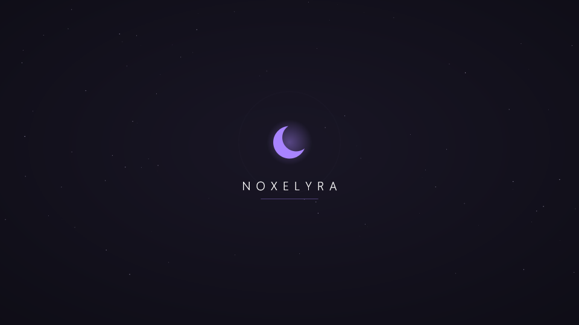

<p align="center"></p>

<h1 align="center">Noxelyra</h1>
<p align="center"><b>Windows 11 için Linux rice ruhunda, yumuşak ve kişiselleştirilebilir bir masaüstü katmanı.</b><br>
<sub>A soft, Linux-rice-style desktop layer for Windows 11 — bar, dock, widgets, its own desktop and a lighten center, without replacing Explorer.</sub></p>

<p align="center">v0.37 · .NET 10 WPF · MIT</p>

> [!TIP]
> ### 📥 Nasıl kurulur? (30 saniye)
> 1. **[Noxelyra-win-Setup.exe'yi indir](https://github.com/Claxe-exe/Noxelyra/releases/latest/download/Noxelyra-win-Setup.exe)** (~90 MB, her zaman en son sürüm)
> 2. İndirdiğin dosyayı çalıştır. Windows "*bilgisayarınızı korudu*" derse **Ek bilgi → Yine de çalıştır**'a bas (dosya imzasız olduğu için çıkar).
> 3. Bu kadar! Noxelyra masaüstüne ve Başlat menüsüne eklenir, yeni sürümleri kendisi indirir. Ayrıca .NET kurman gerekmez.
>
> Kurulum istemiyorsan: [taşınabilir sürüm (ZIP)](https://github.com/Claxe-exe/Noxelyra/releases/latest/download/Noxelyra-win-Portable.zip) indir, bir klasöre çıkar, içindeki `Noxelyra.exe`'yi aç.
>
> ⚠️ Yeşil **Code → Download ZIP** düğmesi uygulamayı değil **kaynak kodunu** indirir; içinde çalıştırılacak bir program yoktur. **EN:** Noxelyra is a soft, Linux-rice-style desktop layer for Windows 11, built with C# / .NET 10 / WPF: a Waybar-like glass bar with an iPhone-style dynamic island, quick settings, Hyprland-style dwindle tiling, a Win-key launcher and its own Alt+Tab, a paged dock with drag-and-drop pinning, its own desktop that Win+D shows, seven themes including Catppuccin and Tokyo Night, a TV-style boot animation (or your own 10-second clip) and a restorable lighten center for startup apps and Windows extras. Explorer is never replaced. Interface in Turkish.

---

## Neler var

| | |
|---|---|
| **Üst bar** | Hyprland/Waybar tarzı cam adacıklar: başlatıcı, odaktaki pencere, ses (tekerlekle), CPU/RAM, palet menüsü, tepsi düğmesi. |
| **Dinamik ada** | Saat adası çalan parçayı, ses değişimini, bildirimleri ve zamanlayıcıyı gösterir. Tıklayınca iki sayfalık kart açılır: parça (±10 sn), hava, CPU/GPU/RAM; ses, mikrofon, parlaklık, ekran görüntüsü, donan uygulamayı kapatma. **Alt+0** kartı oyundayken bile üste getirir. |
| **Hızlı ayarlar** | Bardan kayan panel: rahatsız etme, döşeme, koyu Windows, görev çubuğu, ses, çalan parça, paletler ve Noxelyra bildirimleri. |
| **Klavye** | Win tuşu başlatıcıyı açar, canlı önizlemeli kendi Alt+Tab, Hyprland "dwindle" otomatik döşeme, kısayol düzenleyici. Acil çıkış: **Ctrl+Shift+Ü**. (İlk üçü varsayılan kapalı.) |
| **Dock** | Sürükle-bırak ile sabitleme, sayfalar (1-2-3, tekerlek), macOS benzeri dalga büyütme, çalışan uygulama göstergesi. |
| **Kendi masaüstü** | Gerçek masaüstü dosyaların; widget ve dock'un etrafından dizilen simgeler, kendi arka plan resmin veya videon. **Win+D / Win+M** Noxelyra masaüstünü gösterir. |
| **Temalar** | Midnight, Tempest, Sakura, Catppuccin Mocha, Tokyo Night, Nord, Rosé Pine. Windows'u koyu moda ve palet rengine eşleyebilir. |
| **Açılış / kapanış** | TV açılışı gibi ışık çizgisi, zıplayan noktalar ve hilal; ya da kendi 10 saniyelik MP4/GIF klibin, kararma ve TV geçişiyle. |
| **Hafifletme** | Gerçek RAM kullanımı, açılışta başlayan programlar, Windows ekstraları; isteğe bağlı (UAC'li) telemetri / SysMain / arama servisleri. Hepsi geri alınabilir. |
| **Widget'lar** | Saat, büyük saat, takvim, not, sistem, son 60 sn CPU/GPU/RAM/disk/ağ grafiği, kapaklı müzik kartı, hava durumu (Open-Meteo) ve izinleri kısıtlı yerel HTML/CSS/JS widget'ları. |
| **Noxelyra Music** | Videosu adanın arkasında oynayan eşlikçi oynatıcı ([ayrı repo](https://github.com/Claxe-exe/Noxelyra-Music)). Kontrol merkezinden veya boş adadan tek tuşla kurulur. |
| **Rice** | Duvar kâğıdından okunaklı tema rengi; bütün görünümü tek `.noxrice` dosyasıyla paylaş ve içe aktar. |

<p align="center"> </p>

## Kurulum

Setup.exe kullanıcı kapsamında kurar (yönetici izni istemez): `%LOCALAPPDATA%\Noxelyra`, masaüstü ve Başlat menüsü kısayolu, Ayarlar → Uygulamalar'da kaldırma girdisi. Kaldırırken önce Windows'un görev çubuğu, arka planı ve Noxelyra'nın değiştirdiği diğer ayarlar geri yüklenir; kişisel ayarların `%LOCALAPPDATA%\ClaxeDesktop` altında korunur.

**Gerekenler:** Windows 11 x64. Web widget'ları için WebView2 Runtime (Windows 11'de hazır gelir). .NET pakete gömülüdür.

**Güncellemeler:** Kurulu sürüm açılışta bu deponun GitHub sürümlerini denetler, yenisini arka planda indirir ve kapanışta kurar. Kontrol merkezi → Güncellemeler'den kapatabilir ya da "Güncelle ve yeniden başlat" diyebilirsin. Senden hiçbir bilgi gönderilmez.

## Güvenlik

Noxelyra Explorer'ı kapatmaz ya da değiştirmez, DLL enjekte etmez, telemetri göndermez. Ağ istekleri yalnız kapatılabilir güncelleme denetimi ve senin eklediğin hava durumu widget'ıdır. Windows'ta değiştirdiği her şeyin eski halini kaydeder ve çıkışta, kaldırmada veya çökme sonrası geri getirir. Ayrıntı: [SECURITY.md](SECURITY.md).

## Geliştirme

```powershell
dotnet build ClaxeDesktop.sln -c Release
dotnet run --project tests/ClaxeDesktop.Core.Tests -c Release -- --desktop   # masaüstü, tema, hafifletme kontrolleri
dotnet run --project tests/ClaxeDesktop.Core.Tests -c Release -- --widgets   # widget kontrolleri
dotnet run --project tests/ClaxeDesktop.Core.Tests -c Release -- --v033      # bildirim, hava durumu, palet ve rice kontrolleri
./scripts/Verify-Noxelyra.ps1    # izole veri klasöründe 12 uygulama kontrolü
./scripts/Verify-V033.ps1        # dinamik ada, hızlı ayarlar, Alt+Tab, widget'lar, palet ve rice: 11 kontrol
./scripts/Package-Setup.ps1      # Velopack: Setup.exe, taşınabilir zip, güncelleme paketleri (-Upload ile GitHub'a)
```

Proje yapısı: `ClaxeDesktop.Core` (modeller, ayarlar, kurallar), `ClaxeDesktop.Platform.Win` (Windows API sarmalayıcıları), `ClaxeDesktop.WebWidgets` (WebView2 sandbox), `ClaxeDesktop.App` (WPF arayüz). Ad alanları geriye uyumluluk için `ClaxeDesktop` olarak kalır. Sürüm geçmişi [CHANGELOG.md](CHANGELOG.md), mimari kararlar [DECISIONS.md](DECISIONS.md), ayrıntılı tasarım ve faz raporları `docs/` altında.

## Bilinen sınırlar

- Başka uygulamaların başlık çubukları ve Windows bildirimleri yeniden tasarlanamaz (enjeksiyon gerektirir).
- Windows sanal masaüstleri için kararlı bir API olmadığından barda çalışma alanı modülü yok.
- "Panel için çalışma alanı ayır" modunda barın 48 px aşağı kayması için koruma eklendi; hatanın görüldüğü sistemde henüz doğrulanmadı.
- Dinamik ada ve bildirim merkezi yalnız Noxelyra'nın kendi bildirimlerini gösterir; başka uygulamaların Windows bildirimleri paketlenmemiş bir uygulamadan okunamaz.
- Döşeme belgelenmiş pencere API'leriyle çalışır; bazı uygulamalar (yönetici olarak çalışanlar, kendi pencere çerçevesini çizenler) konumlandırmayı reddedebilir ve serbest kalır.
- Temiz VM, karma DPI ve fiziksel uyku testleri henüz tamamlanmadı.

## Lisans

[MIT](LICENSE). Üçüncü taraf bileşenler: [THIRD_PARTY_NOTICES.md](THIRD_PARTY_NOTICES.md).
